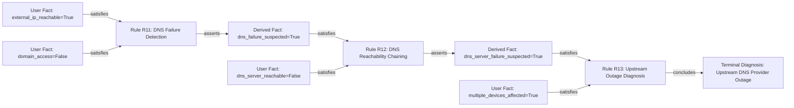

# NetSage Explanation Engine Documentation

The NetSage Explanation Engine provides transparent, explainable reasoning for both ongoing inquiries (WHY) and final diagnoses (HOW).

---

## 1. Dynamic WHY Explanation Facility

Whenever the diagnostic interface presents a question, the user can inspect an expandable **"WHY THIS QUESTION?"** drawer.

### Structure of `WhyExplanation`:
```python
{
    "question_id": "Q13",
    "question_text": "Can your device reach or ping its configured DNS server IP address?",
    "fact_key": "dns_server_reachable",
    "investigating_hypothesis": "Upstream DNS Provider Outage",
    "hypothesis_category": "DNS",
    "triggering_rule_id": "R12",
    "triggering_rule_name": "DNS Server Reachability Chaining",
    "rationale": "Given that public IP ping responds, and domain name resolution fails, we are testing whether 'dns_server_reachable' is present. Rule R12 requires this premise to evaluate 'Upstream DNS Provider Outage'.",
    "impact_if_yes": "If YES: Establishes 'dns_server_reachable' as confirmed evidence, allowing Rule R15/R16 to evaluate local DNS cache or port 53 filtering.",
    "impact_if_no": "If NO: Refutes local DNS resolver health and proves the assigned DNS server is unreachable, progressing toward confirming an upstream DNS provider outage."
}
```

The explanation is synthesized from:
1. Current working memory facts already asserted.
2. The active backward-chaining candidate hypothesis.
3. The specific antecedent rule condition being tested.

---

## 2. Comprehensive HOW Explanation Facility

After reaching a diagnosis (or arriving at an inconclusive state), the Explanation Center displays the complete retrospective reasoning trace.

### Structure of `HowExplanation`:
- `session_status`: `COMPLETED`, `INCONCLUSIVE`, or `CONFLICT_DETECTED`.
- `final_diagnosis`: Name of confirmed terminal diagnosis (e.g. `"Upstream DNS Provider Outage"`).
- `diagnosis_category`: E.g. `"DNS"`.
- `diagnosis_severity`: E.g. `"HIGH"`.
- `initial_user_evidence`: Key-value map of all facts supplied by the user.
- `derived_intermediate_facts`: Key-value map of intermediate facts asserted by fired rules.
- `fired_rules_count`: Total number of production rules that fired.
- `execution_steps`: Chronological list of `InferenceTraceStep` records.
- `reasoning_narrative`: Human-readable paragraph-by-paragraph deductive explanation.
- `inference_tree`: Structured Directed Acyclic Graph (DAG) for visual rendering.

### Inference Tree (DAG) Visualization Model:

Nodes in the DAG are typed:
- `USER_FACT`: Directly entered evidence.
- `RULE`: Production rule instance with firing order.
- `DERIVED_FACT`: Inferred intermediate condition.
- `TERMINAL_DIAGNOSIS`: Final verified fault state.

