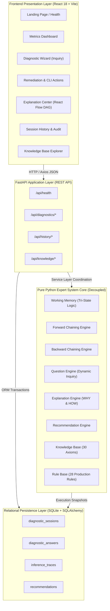

# NetSage Full-Stack Architecture & Integration Guide

NetSage is an intelligent Knowledge-Based Expert System (KBES) designed to systematically troubleshoot and resolve local network, gateway, DNS, Wi-Fi, performance, and ISP connectivity issues.

---

## 1. System Architecture



---

## 2. Environment Configuration

### Backend (`backend/.env` or system environment):
| Variable | Default Value | Description |
| :--- | :--- | :--- |
| `DATABASE_URL` | `sqlite:///./netsage.db` | SQLite database connection string |
| `API_HOST` | `127.0.0.1` | Local backend binding interface |
| `API_PORT` | `8000` | Backend listening TCP port |
| `LOG_LEVEL` | `INFO` | Application log verbosity |

### Frontend (`frontend/.env` or Vite proxy):
| Variable | Default Value | Description |
| :--- | :--- | :--- |
| `VITE_API_URL` | `/api` | Base path for REST API calls (proxied to `http://127.0.0.1:8000`) |
| `PORT` | `5173` | Frontend dev and preview TCP port |

---

## 3. Application Startup Instructions

### Starting the FastAPI Backend:
```powershell
# From project root:
.\.venv\Scripts\activate
uvicorn app.main:app --port 8000 --host 127.0.0.1 --app-dir backend
```
* Backend health check: `http://127.0.0.1:8000/api/health`
* Interactive OpenAPI Swagger docs: `http://127.0.0.1:8000/docs`

### Starting the React Frontend:
```powershell
# In a separate terminal from project root:
cd frontend
npm run dev
```
* Application interface: `http://127.0.0.1:5173`

---

## 4. End-to-End Diagnostic Workflows (All 6 Problem Categories)

### Category 1: IP / DHCP Configuration Failure
* **Goal**: Detect local Layer 3 configuration failures or rogue/unresponsive DHCP servers.
* **Inquiry Path**:
  1. `device_connected` (Q01) $\rightarrow$ **YES**
  2. `ip_is_apipa` (Q12) $\rightarrow$ **YES** (169.254.x.x link-local autoconfiguration detected)
  3. `valid_ip` (Q03) $\rightarrow$ **NO**
  4. `multiple_devices_affected` (Q07) $\rightarrow$ **YES**
* **Inference Rule Chain**: $R01 \rightarrow R03 \rightarrow R04$ (Terminal)
* **Confirmed Diagnosis**: `Router DHCP Server Failure` (Severity: `HIGH`)
* **Remediation Plan**: Release/renew IP (`ipconfig /release && ipconfig /renew`), inspect DHCP service pool on local gateway router.

### Category 2: DNS Resolution Outage
* **Goal**: Discriminate DNS name translation failures from general Layer 3 internet disconnection.
* **Inquiry Path**:
  1. `external_ip_reachable` (Q05) $\rightarrow$ **YES** (Ping to 8.8.8.8 succeeds)
  2. `domain_access` (Q06) $\rightarrow$ **NO** (Cannot open web pages by hostname)
  3. `dns_server_reachable` (Q13) $\rightarrow$ **NO** (Configured DNS server fails to respond)
  4. `multiple_devices_affected` (Q07) $\rightarrow$ **YES**
* **Inference Rule Chain**: $R11 \rightarrow R12 \rightarrow R13$ (Terminal)
* **Confirmed Diagnosis**: `Upstream DNS Provider Outage` (Severity: `MEDIUM`)
* **Remediation Plan**: Flush local DNS resolver cache (`ipconfig /flushdns`), reconfigure network adapter with public fallback resolvers (`1.1.1.1`, `8.8.8.8`).

### Category 3: Gateway Connectivity Failure
* **Goal**: Detect router hardware lockups, gateway ARP resolution failures, or physical link failures.
* **Inquiry Path**:
  1. `valid_ip` (Q03) $\rightarrow$ **YES**
  2. `gateway_reachable` (Q04) $\rightarrow$ **NO** (Ping to local default gateway fails)
  3. `multiple_devices_affected` (Q07) $\rightarrow$ **YES**
  4. `router_reboot_temporarily_fixed` (Q15) $\rightarrow$ **YES**
* **Inference Rule Chain**: $R06 \rightarrow R07 \rightarrow R08 \rightarrow R09$ (Terminal)
* **Confirmed Diagnosis**: `Router Gateway Crash / Hardware Overload` (Severity: `HIGH`)
* **Remediation Plan**: Power-cycle router/modem gateway, check router CPU/memory exhaustion, update router firmware.

### Category 4: Wi-Fi Signal Attenuation & Interference
* **Goal**: Isolate wireless 802.11 RF degradation, high distance attenuation, and co-channel interference.
* **Inquiry Path**:
  1. `using_wifi` (Q02) $\rightarrow$ **YES**
  2. `wifi_signal_weak` (Q09) $\rightarrow$ **YES** (RSSI weaker than -75 dBm)
  3. `frequent_disconnections` (Q08) $\rightarrow$ **YES**
  4. `problem_on_ethernet_too` (Q14) $\rightarrow$ **NO** (Wired connections operate normally)
* **Inference Rule Chain**: $R17 \rightarrow R18 \rightarrow R19$ (Terminal)
* **Confirmed Diagnosis**: `Wi-Fi Signal Attenuation and Range Limitation` (Severity: `MEDIUM`)
* **Remediation Plan**: Move closer to AP, switch to 5 GHz band, change wireless channel width to 20/40 MHz to avoid interference.

### Category 5: Packet Loss / High Latency / Bufferbloat
* **Goal**: Identify bufferbloat queuing delays, interface saturation, and degraded line quality.
* **Inquiry Path**:
  1. `high_latency_observed` (Q10) $\rightarrow$ **YES** (RTT spikes over 150ms under load)
  2. `heavy_bandwidth_usage` (Q16) $\rightarrow$ **YES** (Concurrent streaming / peer-to-peer uploads active)
* **Inference Rule Chain**: $R21 \rightarrow R22 \rightarrow R23$ (Terminal)
* **Confirmed Diagnosis**: `Local Network Bufferbloat & Bandwidth Saturation` (Severity: `MEDIUM`)
* **Remediation Plan**: Enable Smart Queue Management (SQM / fq_codel / CAKE) on router, throttle high-bandwidth torrenting/uploads.

### Category 6: Wide-Area ISP Service Outage
* **Goal**: Confirm wide-area WAN outages beyond the local gateway boundary.
* **Inquiry Path**:
  1. `gateway_reachable` (Q04) $\rightarrow$ **YES** (Local router is responsive)
  2. `external_ip_reachable` (Q05) $\rightarrow$ **NO** (Public WAN cannot be reached)
  3. `multiple_devices_affected` (Q07) $\rightarrow$ **YES**
* **Inference Rule Chain**: $R25 \rightarrow R26 \rightarrow R27$ (Terminal)
* **Confirmed Diagnosis**: `Wide-Area ISP Service Outage` (Severity: `CRITICAL`)
* **Remediation Plan**: Inspect modem WAN optical/coaxial link LED indicators, contact Internet Service Provider NOC.

---

## 5. Explanation Center DAG Structure

The Explanation Center renders an interactive Directed Acyclic Graph (DAG) using **React Flow** and **Dagre**:
* **`USER_FACT` (Cyan nodes)**: Diagnostic evidence provided directly by user responses.
* **`RULE` (Indigo nodes)**: Production rules whose antecedent conjunctions were satisfied.
* **`DERIVED_FACT` (Emerald nodes)**: Intermediate conclusions asserted into working memory without terminating inference.
* **`TERMINAL_DIAGNOSIS` (Rose nodes)**: Verified terminal diagnosis concluding the diagnostic session.

Every node and edge is generated directly from the backend inference trace snapshot (`/api/diagnostics/{session_id}/explanation`).

---

## 6. Operational Boundaries & Known Limitations

1. **Deterministic Logic Only**: NetSage does not use generative AI, probabilistic neural networks, or LLMs. All diagnostic conclusions are mathematically derived from verified production rules.
2. **Operator-Assisted Observation**: The expert system relies on operator-reported command observations (`ipconfig`, `ping`, `tracert`, `nslookup`).
3. **Layer 1-4 Scope**: The knowledge base addresses OSI Model Layers 1 through 4 (Physical/Link, Network, Transport) and Layer 7 DNS services. Advanced BGP multi-homing or enterprise MPLS routing are out of scope.

