# NetSage Production Rule Base Documentation

NetSage implements 28 production rules partitioned into six diagnostic categories ($N01$ to $N06$).
Every rule features:
- Unique identifier (`R01`–`R28`).
- Formal category and firing priority.
- Structural classification: `INTERMEDIATE` vs. `TERMINAL_DIAGNOSIS`.
- Antecedent conditions under 3-valued logic (`TRUE`, `FALSE`, `UNKNOWN`).
- Actionable conclusion assertions.
- Complete domain explanation.

---

## 1. Complete Rule Inventory (R01 – R28)

### Category A: IP / DHCP Problems (N02)

#### R01 — Automatic IP Configuration Failure (APIPA Detection)
- **Classification**: `INTERMEDIATE`
- **Priority**: 80
- **IF**:
  - `device_connected == True`
  - `ip_is_apipa == True`
- **THEN**: `dhcp_failure_suspected = True`
- **Explanation**: Device is connected to the network but received an APIPA address (169.254.x.x), indicating DHCP assignment failed.
- **Triggers**: `R03`, `R05`

#### R02 — Invalid IP Configuration Detection
- **Classification**: `INTERMEDIATE`
- **Priority**: 75
- **IF**:
  - `device_connected == True`
  - `valid_ip == False`
  - `ip_is_apipa == False`
- **THEN**: `ip_config_failure = True`
- **Explanation**: Device is connected but does not possess a valid routable IP configuration.

#### R03 — DHCP Server Unavailability Chaining
- **Classification**: `INTERMEDIATE`
- **Priority**: 85
- **IF**:
  - `dhcp_failure_suspected == True` *(derived from R01)*
  - `valid_ip == False`
- **THEN**: `dhcp_server_unavailable = True`
- **Explanation**: DHCP failure is suspected and device lacks a valid IP, confirming the local DHCP service is unavailable.
- **Triggers**: `R04`

#### R04 — Router DHCP Server Failure Diagnosis
- **Classification**: `TERMINAL_DIAGNOSIS`
- **Priority**: 90
- **IF**:
  - `dhcp_server_unavailable == True` *(derived from R03)*
  - `multiple_devices_affected == True`
- **THEN**:
  - `diagnosis = "Router DHCP Server Failure"`
  - `diagnosis_category = "IP_DHCP"`
  - `diagnosis_severity = "HIGH"`
  - `recommendation_code = "REC_DHCP_ROUTER"`
- **Explanation**: Multiple devices are unable to obtain IP addresses via DHCP, pointing to a router DHCP daemon failure or address pool exhaustion.

#### R05 — Host DHCP Client Lease Failure Diagnosis
- **Classification**: `TERMINAL_DIAGNOSIS`
- **Priority**: 88
- **IF**:
  - `dhcp_failure_suspected == True` *(derived from R01)*
  - `multiple_devices_affected == False`
- **THEN**:
  - `diagnosis = "Host DHCP Client Lease Failure"`
  - `diagnosis_category = "IP_DHCP"`
  - `diagnosis_severity = "MEDIUM"`
  - `recommendation_code = "REC_DHCP_CLIENT"`
- **Explanation**: DHCP failure is isolated to this single host, indicating a local network adapter or DHCP client service failure.

---

### Category B: Gateway Connectivity Problems (N03)

#### R06 — Default Gateway Unreachable Detection
- **Classification**: `INTERMEDIATE`
- **Priority**: 80
- **IF**:
  - `valid_ip == True`
  - `gateway_reachable == False`
- **THEN**: `gateway_failure_suspected = True`
- **Explanation**: Device holds a valid IP address but cannot reach or ping its default gateway.
- **Triggers**: `R07`, `R08`, `R10`

#### R07 — Local Segment Link Problem Chaining
- **Classification**: `INTERMEDIATE`
- **Priority**: 75
- **IF**:
  - `gateway_failure_suspected == True` *(derived from R06)*
- **THEN**: `local_network_problem = True`
- **Explanation**: Inability to communicate with default gateway isolates the problem to the local physical or Layer 2 segment.

#### R08 — Router Hardware Failure Suspicion
- **Classification**: `INTERMEDIATE`
- **Priority**: 85
- **IF**:
  - `gateway_failure_suspected == True` *(derived from R06)*
  - `multiple_devices_affected == True`
- **THEN**: `router_hardware_suspected = True`
- **Explanation**: Gateway is unreachable across multiple devices, indicating a router hardware crash or local switch failure.
- **Triggers**: `R09`

#### R09 — Router Gateway Crash / Hardware Overload Diagnosis
- **Classification**: `TERMINAL_DIAGNOSIS`
- **Priority**: 90
- **IF**:
  - `router_hardware_suspected == True` *(derived from R08)*
  - `router_reboot_temporarily_fixed == True`
- **THEN**:
  - `diagnosis = "Router Gateway Crash / Hardware Overload"`
  - `diagnosis_category = "GATEWAY"`
  - `diagnosis_severity = "HIGH"`
  - `recommendation_code = "REC_GATEWAY_REBOOT"`
- **Explanation**: Router gateway locks up under load and reboot temporarily restores communication, confirming router firmware or RAM exhaustion.

#### R10 — Host Gateway Route / ARP Failure Diagnosis
- **Classification**: `TERMINAL_DIAGNOSIS`
- **Priority**: 88
- **IF**:
  - `gateway_failure_suspected == True` *(derived from R06)*
  - `multiple_devices_affected == False`
- **THEN**:
  - `diagnosis = "Local Gateway Connectivity Failure (Host Specific)"`
  - `diagnosis_category = "GATEWAY"`
  - `diagnosis_severity = "MEDIUM"`
  - `recommendation_code = "REC_GATEWAY_LOCAL"`
- **Explanation**: Only this device cannot ping the gateway while other devices can, pointing to a local subnet mismatch, bad static route, or corrupted ARP cache.

---

### Category C: DNS Problems (N01)

#### R11 — DNS Resolution Failure Detection
- **Classification**: `INTERMEDIATE`
- **Priority**: 85
- **IF**:
  - `external_ip_reachable == True`
  - `domain_access == False`
- **THEN**: `dns_failure_suspected = True`
- **Explanation**: External IP is directly reachable (proving internet routing works), but domain names cannot be resolved.
- **Triggers**: `R12`, `R15`

#### R12 — DNS Server Reachability Chaining
- **Classification**: `INTERMEDIATE`
- **Priority**: 88
- **IF**:
  - `dns_failure_suspected == True` *(derived from R11)*
  - `dns_server_reachable == False`
- **THEN**: `dns_server_failure_suspected = True`
- **Explanation**: DNS failure is suspected and the assigned DNS server IP does not respond to ping.
- **Triggers**: `R13`, `R14`

#### R13 — Upstream DNS Provider Outage Diagnosis
- **Classification**: `TERMINAL_DIAGNOSIS`
- **Priority**: 92
- **IF**:
  - `dns_server_failure_suspected == True` *(derived from R12)*
  - `multiple_devices_affected == True`
- **THEN**:
  - `diagnosis = "Upstream DNS Provider Outage"`
  - `diagnosis_category = "DNS"`
  - `diagnosis_severity = "HIGH"`
  - `recommendation_code = "REC_DNS_UPSTREAM"`
- **Explanation**: Configured DNS server is unreachable across multiple devices on the network, confirming an upstream ISP or DNS provider outage.

#### R14 — Invalid Host DNS Server Configuration Diagnosis
- **Classification**: `TERMINAL_DIAGNOSIS`
- **Priority**: 90
- **IF**:
  - `dns_server_failure_suspected == True` *(derived from R12)*
  - `multiple_devices_affected == False`
- **THEN**:
  - `diagnosis = "Invalid Local DNS Server Configuration"`
  - `diagnosis_category = "DNS"`
  - `diagnosis_severity = "MEDIUM"`
  - `recommendation_code = "REC_DNS_LOCAL"`
- **Explanation**: Assigned DNS server is unreachable only on this host, indicating incorrect static DNS entry or host-level firewall block.

#### R15 — DNS Cache or Resolver Glitch Chaining
- **Classification**: `INTERMEDIATE`
- **Priority**: 86
- **IF**:
  - `dns_failure_suspected == True` *(derived from R11)*
  - `dns_server_reachable == True`
- **THEN**: `dns_config_problem_suspected = True`
- **Explanation**: DNS server is reachable via ping, but name resolution fails, indicating cached corrupt records or port 53 UDP filtering.
- **Triggers**: `R16`

#### R16 — DNS Cache Corruption / Local Resolver Failure Diagnosis
- **Classification**: `TERMINAL_DIAGNOSIS`
- **Priority**: 84
- **IF**:
  - `dns_config_problem_suspected == True` *(derived from R15)*
- **THEN**:
  - `diagnosis = "DNS Cache Corruption / Local Resolver Failure"`
  - `diagnosis_category = "DNS"`
  - `diagnosis_severity = "LOW"`
  - `recommendation_code = "REC_DNS_FLUSH"`
- **Explanation**: DNS server responds but lookup fails, pointing to stale OS DNS resolver cache or corrupted hosts file.

---

### Category D: Wi-Fi Problems (N04)

#### R17 — Weak Wi-Fi Signal Detection
- **Classification**: `INTERMEDIATE`
- **Priority**: 75
- **IF**:
  - `using_wifi == True`
  - `wifi_signal_weak == True`
- **THEN**: `weak_wifi_suspected = True`
- **Explanation**: Device is connected to Wi-Fi with weak radio signal strength (low RSSI).
- **Triggers**: `R18`

#### R18 — Wireless Link Instability Chaining
- **Classification**: `INTERMEDIATE`
- **Priority**: 80
- **IF**:
  - `weak_wifi_suspected == True` *(derived from R17)*
  - `frequent_disconnections == True`
- **THEN**: `wireless_instability_suspected = True`
- **Explanation**: Weak Wi-Fi signal combined with frequent disconnections confirms severe RF link instability.
- **Triggers**: `R19`

#### R19 — Wi-Fi Signal Attenuation & Range Limitation Diagnosis
- **Classification**: `TERMINAL_DIAGNOSIS`
- **Priority**: 85
- **IF**:
  - `wireless_instability_suspected == True` *(derived from R18)*
  - `problem_on_ethernet_too == False`
- **THEN**:
  - `diagnosis = "Wi-Fi Signal Attenuation and Range Limitation"`
  - `diagnosis_category = "WIFI"`
  - `diagnosis_severity = "MEDIUM"`
  - `recommendation_code = "REC_WIFI_RANGE"`
- **Explanation**: Wireless connection suffers drops due to low signal while Ethernet works cleanly, confirming excessive physical distance or RF obstruction.

#### R20 — Wireless Radio Interference / Channel Congestion Diagnosis
- **Classification**: `TERMINAL_DIAGNOSIS`
- **Priority**: 82
- **IF**:
  - `using_wifi == True`
  - `wifi_signal_weak == False`
  - `frequent_disconnections == True`
  - `problem_on_ethernet_too == False`
- **THEN**:
  - `diagnosis = "Wireless Radio Interference / Channel Congestion"`
  - `diagnosis_category = "WIFI"`
  - `diagnosis_severity = "MEDIUM"`
  - `recommendation_code = "REC_WIFI_INTERFERENCE"`
- **Explanation**: Wi-Fi signal strength is strong yet disconnections occur only on Wi-Fi, indicating co-channel interference from neighboring APs or microwave/Bluetooth sources.

---

### Category E: Performance / Latency / Packet Loss (N05)

#### R21 — Network Degradation Detection
- **Classification**: `INTERMEDIATE`
- **Priority**: 70
- **IF**:
  - `high_latency_observed == True`
- **THEN**: `network_performance_degraded = True`
- **Explanation**: Consistent round-trip latency exceeding normal thresholds indicates network performance degradation.
- **Triggers**: `R22`, `R24`

#### R22 — Network Congestion Chaining
- **Classification**: `INTERMEDIATE`
- **Priority**: 75
- **IF**:
  - `network_performance_degraded == True` *(derived from R21)*
  - `heavy_bandwidth_usage == True`
- **THEN**: `network_congestion_suspected = True`
- **Explanation**: High latency concurrent with heavy local bandwidth usage confirms local egress queue congestion.
- **Triggers**: `R23`

#### R23 — Local Network Bufferbloat & Congestion Diagnosis
- **Classification**: `TERMINAL_DIAGNOSIS`
- **Priority**: 80
- **IF**:
  - `network_congestion_suspected == True` *(derived from R22)*
- **THEN**:
  - `diagnosis = "Local Network Bufferbloat & Bandwidth Saturation"`
  - `diagnosis_category = "PERFORMANCE"`
  - `diagnosis_severity = "MEDIUM"`
  - `recommendation_code = "REC_PERF_CONGESTION"`
- **Explanation**: Heavy traffic saturating router egress queues causes router bufferbloat and latency spikes.

#### R24 — Physical Line Degradation / Upstream Packet Loss Diagnosis
- **Classification**: `TERMINAL_DIAGNOSIS`
- **Priority**: 82
- **IF**:
  - `network_performance_degraded == True` *(derived from R21)*
  - `packet_loss_observed == True`
  - `heavy_bandwidth_usage == False`
- **THEN**:
  - `diagnosis = "Physical Line Degradation or ISP Packet Loss"`
  - `diagnosis_category = "PERFORMANCE"`
  - `diagnosis_severity = "HIGH"`
  - `recommendation_code = "REC_PERF_PACKETLOSS"`
- **Explanation**: Packet loss occurs without local bandwidth saturation, indicating physical line noise, bad Ethernet cabling, or upstream ISP router drops.

---

### Category F: ISP / Internet Outage (N06)

#### R25 — ISP External Connectivity Failure Detection
- **Classification**: `INTERMEDIATE`
- **Priority**: 85
- **IF**:
  - `gateway_reachable == True`
  - `external_ip_reachable == False`
- **THEN**: `isp_failure_suspected = True`
- **Explanation**: Local gateway is reachable, but outside public IP addresses cannot be reached, isolating the fault to the WAN interface or ISP.
- **Triggers**: `R26`, `R28`

#### R26 — ISP Outage Chaining
- **Classification**: `INTERMEDIATE`
- **Priority**: 90
- **IF**:
  - `isp_failure_suspected == True` *(derived from R25)*
  - `multiple_devices_affected == True`
- **THEN**: `isp_outage_suspected = True`
- **Explanation**: External IP unreachable across multiple independent devices confirms an infrastructure-wide internet outage.
- **Triggers**: `R27`

#### R27 — Wide-Area ISP Service Outage Diagnosis
- **Classification**: `TERMINAL_DIAGNOSIS`
- **Priority**: 95
- **IF**:
  - `isp_outage_suspected == True` *(derived from R26)*
- **THEN**:
  - `diagnosis = "Wide-Area ISP Service Outage"`
  - `diagnosis_category = "ISP"`
  - `diagnosis_severity = "CRITICAL"`
  - `recommendation_code = "REC_ISP_OUTAGE"`
- **Explanation**: All local clients communicate with the gateway but cannot reach external internet, confirming an ISP fiber cut, DSLAM failure, or authentication outage.

#### R28 — Host Gateway Routing or Firewall Block Diagnosis
- **Classification**: `TERMINAL_DIAGNOSIS`
- **Priority**: 88
- **IF**:
  - `isp_failure_suspected == True` *(derived from R25)*
  - `multiple_devices_affected == False`
- **THEN**:
  - `diagnosis = "Host-Specific Gateway Routing or Firewall Block"`
  - `diagnosis_category = "ISP"`
  - `diagnosis_severity = "MEDIUM"`
  - `recommendation_code = "REC_HOST_FIREWALL"`
- **Explanation**: Other local network devices have internet access while this host cannot reach external IPs, pointing to a host firewall rule or router parental control/MAC filter.

---

## 2. Multi-Step Chaining Pipelines

NetSage implements genuine chained inference sequences:

```mermaid
flowchart TD
    subgraph DHCP_Chain["Category A: DHCP Pipeline"]
        R01["R01: APIPA Detection"] -->|dhcp_failure_suspected| R03["R03: DHCP Server Unavailability"]
        R03 -->|dhcp_server_unavailable| R04["R04: Router DHCP Server Failure (Terminal)"]
        R01 -->|dhcp_failure_suspected| R05["R05: Host DHCP Client Failure (Terminal)"]
    end

    subgraph Gateway_Chain["Category B: Gateway Pipeline"]
        R06["R06: Gateway Unreachable"] -->|gateway_failure_suspected| R07["R07: Local Segment Link Problem"]
        R06 -->|gateway_failure_suspected| R08["R08: Router Hardware Suspicion"]
        R08 -->|router_hardware_suspected| R09["R09: Router Crash/Overload (Terminal)"]
        R06 -->|gateway_failure_suspected| R10["R10: Local Host Route/ARP (Terminal)"]
    end

    subgraph DNS_Chain["Category C: DNS Pipeline"]
        R11["R11: DNS Resolution Failure"] -->|dns_failure_suspected| R12["R12: DNS Server Reachability"]
        R12 -->|dns_server_failure_suspected| R13["R13: Upstream DNS Outage (Terminal)"]
        R12 -->|dns_server_failure_suspected| R14["R14: Host DNS Config (Terminal)"]
        R11 -->|dns_failure_suspected| R15["R15: DNS Cache/Resolver Glitch"]
        R15 -->|dns_config_problem_suspected| R16["R16: DNS Cache Corruption (Terminal)"]
    end

    subgraph WiFi_Chain["Category D: Wi-Fi Pipeline"]
        R17["R17: Weak Wi-Fi Signal"] -->|weak_wifi_suspected| R18["R18: Wireless Link Instability"]
        R18 -->|wireless_instability_suspected| R19["R19: Wi-Fi Range Attenuation (Terminal)"]
    end

    subgraph Perf_Chain["Category E: Performance Pipeline"]
        R21["R21: High Latency Detection"] -->|network_performance_degraded| R22["R22: Network Congestion"]
        R22 -->|network_congestion_suspected| R23["R23: Bufferbloat Saturation (Terminal)"]
        R21 -->|network_performance_degraded| R24["R24: Upstream Packet Loss (Terminal)"]
    end

    subgraph ISP_Chain["Category F: ISP Pipeline"]
        R25["R25: ISP Connectivity Failure"] -->|isp_failure_suspected| R26["R26: ISP Outage Suspicion"]
        R26 -->|isp_outage_suspected| R27["R27: Wide-Area ISP Outage (Terminal)"]
        R25 -->|isp_failure_suspected| R28["R28: Host Gateway Routing Block (Terminal)"]
    end
```

